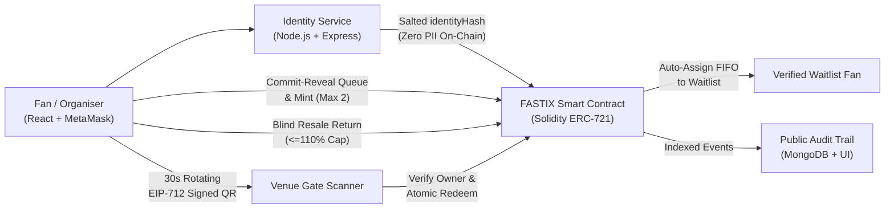

<div align="center">

# FASTIX

### Fair Tickets. Fair Prices. Zero Fakes.

**A blockchain-enforced anti-scalping ticketing protocol built for India's live-event ecosystem.**

[[https://img.shields.io/badge/The%20Big%20Hack%202.0-Track%2002%20%C2%B7%20B2-0A1128?style=for-the-badge&logo=ethereum&logoColor=38BDF8]](https://github.com/<your-username>/FASTIX)
[[https://img.shields.io/badge/Solidity-0.8.24-1E293B?style=for-the-badge&logo=solidity&logoColor=white]](https://soliditylang.org/)
[[https://img.shields.io/badge/Hardhat-Smart%20Contracts-0F172A?style=for-the-badge&logo=ethereum&logoColor=F59E0B]](https://hardhat.org/)
[[https://img.shields.io/badge/React%2018-Vite%20%2B%20Tailwind-0B192C?style=for-the-badge&logo=react&logoColor=38BDF8]](https://react.dev/)
[[https://img.shields.io/badge/Node.js-Express%20%2B%20MongoDB-0A1128?style=for-the-badge&logo=node.js&logoColor=10B981]](https://nodejs.org/)
[[https://img.shields.io/badge/License-MIT-1E3A8A?style=for-the-badge]](LICENSE)

</div>

> **Built for The Big Hack 2.0 (Bengaluru) — Track 02: Cybersecurity & Blockchain (Problem B2: Fair Tickets).**
> Every core security rule—per-human ticket caps, queue randomness, blind-pool resale caps, and one-time gate redemption—is cryptographically enforced on-chain.

## The Problem

Live-event ticketing in India is broken across the entire lifecycle:

| Failure Point | Real-World Evidence in India | Impact on Fans & Artists |
| :--- | :--- | :--- |
| **Bot-Driven Primary Queues** | **1.3 crore** fans entered BookMyShow's queue for Coldplay's Mumbai concerts (Sept 2024); tickets vanished in minutes amid bot allegations. | Automated scripts beat genuine fans on speed-based queues. |
| **Unchecked Scalping** | Resale listings hit **₹3 lakh** within hours—many times face value. India has **no law written specifically against ticket scalping**. | Real fans are priced out while scalpers capture the surplus. |
| **Fake & Duplicated Tickets** | Enforcement Directorate raided **5 cities (including Bengaluru)** in Oct 2024 over fake Coldplay and Diljit Dosanjh tickets sold via Instagram, WhatsApp, and Telegram. | Fans buy forged PDFs or duplicated QR screenshots and are turned away at the gate. |

## Why Blockchain Is Essential (Track 02 Core Rule)

> *"A solution that would work the same way with the blockchain removed does not meet this rule."*

| Capability | Traditional Centralized Platform | FASTIX On-Chain Protocol |
| :--- | :--- | :--- |
| **Queue Fairness** | Opaque server-side queue; fans must blindly trust the platform not to favor insiders or bots. | **Verifiable commit-reveal randomization** anchored on-chain and publicly auditable. |
| **Per-Person Limits** | Enforced in a mutable database; easily bypassed by multi-account scripts or admin overrides. | **Immutable Solidity cap** (max 2 tickets per privacy-preserving `identityHash`). |
| **Resale Price Caps** | Bypassed via off-chain UPI side-payments or account credential trading. | **Direct P2P transfers locked**; tickets only clear through a **blind FIFO escrow pool** at ≤110% face value. |
| **Gate Authenticity** | Static QR/PDF can be screenshotted and sold to 10 buyers simultaneously. | **30-second EIP-712 signed QR** verified against live on-chain ownership + atomic `redeemed` burn. |

## System Architecture



## Security Threat Model & Defenses

| Attack Vector | How Attackers Exploit Legacy Systems | How FASTIX Stops It On-Chain |
| :--- | :--- | :--- |
| **Multi-Wallet Sybil Bots** | Spin up 500 fresh wallets to bypass per-wallet limits. | One-time identity verification generates a salted `identityHash` (nullifier) mapped on-chain: `mapping(bytes32 => uint8) ticketsPerIdentity`. Exceeding 2 tickets reverts regardless of wallet count. |
| **Speed-Based Queue Sniping** | Bots submit checkout requests milliseconds after sales open. | Verified fans join a pre-sale window; queue positions are assigned via commit-reveal randomization so click speed grants zero advantage. |
| **Off-Chain UPI Side-Payments** | Scalper lists at 110% on-chain but demands ₹50,000 off-chain before transferring to a chosen buyer. | Direct `transferFrom` / `safeTransferFrom` is **disabled** for users. Sellers return tickets to a **blind escrow pool** that automatically matches the next waitlisted fan—making buyer selection impossible. |
| **Screenshot & PDF Cloning** | Scammer sells the same static QR screenshot to multiple victims on Telegram/WhatsApp. | The fan app signs `{ticketId, eventId, timestamp}` every **30 seconds** with the owner's wallet key (EIP-712). Screenshots expire in 30s and forged QRs fail `ecrecover` immediately. |
| **Double Entry at the Gate** | Two people attempt to scan a valid ticket seconds apart. | Gate verification triggers an atomic on-chain `redeemTicket()` state transition; any second scan immediately reverts with `TicketAlreadyRedeemed`. |

## Core Smart Contract Interface

The `FASTIX.sol` ERC-721 contract enforces all protocol invariants directly at the EVM layer:

- `createEvent(name, facePrice, maxSupply, maxResaleBps)` — Organiser deploys an event with an immutable supply and resale cap (max `11000` bps = 110%).
- `registerIdentity(bytes32 identityHash, address wallet)` — Links a privacy-preserving identity nullifier to a fan wallet (zero PII stored on-chain).
- `enterQueue(uint256 eventId)` / `finalizeQueue(uint256 eventId, bytes32 seed)` — Fair commit-reveal queue allocation.
- `mintTicket(uint256 eventId)` — Verifies queue eligibility and enforces `ticketsPerIdentity[eventId][identityHash] < 2`.
- `listForBlindResale(uint256 tokenId, uint256 price)` — Enforces `price <= facePrice * 110 / 100`, locks the ticket in escrow, and auto-matches the next verified waitlist buyer.
- `redeemAtGate(uint256 tokenId, uint256 timestamp, bytes signature)` — Verifies EIP-712 signature freshness (≤30s), confirms `signer == ownerOf(tokenId)`, and permanently marks the ticket as `redeemed`.

## Tech Stack

| Layer | Technologies |
| :--- | :--- |
| **Smart Contracts** | Solidity `^0.8.24`, OpenZeppelin (ERC-721), Hardhat, Ethers.js v6, Chai Security Tests |
| **Backend & Indexing** | Node.js, Express.js, MongoDB (Mongoose), Ethers.js v6, Salted Nullifier Identity Service |
| **Frontend & UX** | React 18 (Vite), Tailwind CSS, Framer Motion, Lucide React, MetaMask, `qrcode.react`, `html5-qrcode` |
| **Cryptographic Gate** | EIP-712 Typed Data Signing, 30-Second Rotating Dynamic QR, Atomic On-Chain Redemption |

## Project Structure

```text
FASTIX/
├── contracts/
│   ├── contracts/FASTIX.sol        # Core ERC-721 anti-scalping smart contract
│   ├── scripts/deploy.js           # Local / testnet deployment script
│   ├── test/FASTIX.test.js         # Automated unit & attack-revert test suite
│   └── hardhat.config.js
├── backend/
│   ├── models/                     # MongoDB schemas (Events, Indexed Tx Logs)
│   ├── routes/                     # Identity nullifier, event & audit trail APIs
│   └── server.js                   # Express server + Ethers.js event listener
├── frontend/
│   ├── src/pages/                  # Explorer, Queue Room, My Tickets, Resale Pool, Gate Scanner, Attack Lab
│   └── src/utils/                  # Ethers.js contract helpers & EIP-712 QR signer
└── README.md
```

## Quick Start

### Prerequisites
- **Node.js** `>= 18.x`
- **MongoDB** (local instance or MongoDB Atlas URI)
- **MetaMask** browser extension configured for Hardhat Localhost (`Chain ID: 31337`)

### 1. Clone the Repository
```bash
git clone [https://github.com/](https://github.com/)<your-username>/FASTIX.git
cd FASTIX
```

### 2. Run Smart Contract Tests & Deploy Locally
```bash
cd contracts
npm install
npx hardhat test
npx hardhat node
```

In a second terminal, deploy `FASTIX.sol` to the local Hardhat node:
```bash
cd contracts
npx hardhat run scripts/deploy.js --network localhost
```

### 3. Configure & Start the Backend
```bash
cd backend
npm install
cp .env.example .env
npm run dev
```

### 4. Configure & Launch the Frontend
```bash
cd frontend
npm install
cp .env.example .env
npm run dev
```

### Environment Variables Reference

| Service | Variable | Purpose |
| :--- | :--- | :--- |
| `backend/.env` | `MONGO_URI` | MongoDB connection string for event metadata & indexed logs |
| `backend/.env` | `RPC_URL` | Hardhat local node (`http://127.0.0.1:8545`) or testnet RPC |
| `backend/.env` | `CONTRACT_ADDRESS` | Deployed `FASTIX.sol` contract address |
| `backend/.env` | `IDENTITY_SALT` | Server secret used to derive privacy-preserving `identityHash` |
| `frontend/.env` | `VITE_API_URL` | Backend Express API base URL |
| `frontend/.env` | `VITE_CONTRACT_ADDRESS` | Deployed `FASTIX.sol` contract address for Ethers.js |

## Live Judge Demo & Attack Lab Walkthrough

1. **Organiser Event Creation:** Deploy a concert event on-chain with face price, supply cap, and maximum resale ceiling (≤110%).
2. **Verified Randomized Booking:** Complete one-time identity verification, enter the commit-reveal queue, and mint up to 2 tickets.
3. **Blind-Pool Controlled Resale:** Return a ticket to the escrow contract and watch it automatically clear to the next verified waitlist fan at the capped price.
4. **Dynamic QR Gate Check-In:** Scan the 30-second rotating EIP-712 signed QR code at the Gate Scanner to trigger instant atomic check-in.
5. **Attack Lab (Live Evidence):** Click to launch three real attacks directly from the UI and inspect the live EVM revert logs:
   - **Multi-Wallet Bot Attack:** Second wallet with the same `identityHash` blocked from exceeding the 2-ticket cap.
   - **Scalper Exploit:** Direct P2P transfer or >110% resale listing rejected by the smart contract.
   - **Fake / Screenshotted QR:** Expired or forged QR code rejected at the gate scanner.

## Production Roadmap for India

- **Gasless Web2 UX (ERC-4337):** Embedded smart wallets + paymaster sponsorship so everyday fans never need MetaMask or ETH for gas.
- **UPI On-Ramp Integration:** Seamless INR checkout via UPI mapped to on-chain minting and instant blind-pool refunds.
- **Zero-Knowledge Identity Proofs:** Replace simulated OTP/Aadhaar hashing with client-side ZK proofs (e.g., Anon Aadhaar / DigiLocker ZK).
- **Offline Venue Gate Mode:** Periodic Merkle-root syncing to gate scanners for zero-latency cryptographic verification in congested stadium networks.

## Team

- `[Team Member 1]` — Smart Contracts & Security Architecture
- `[Team Member 2]` — Backend API, Identity Nullifier & Indexing
- `[Team Member 3]` — Frontend Engineering & Motion Design

## License

This project is licensed under the **MIT License** — see the [LICENSE](LICENSE) file for details.
