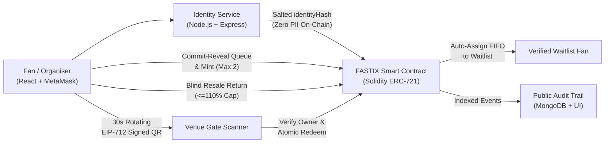

<div align="center">

# FASTIX

### Fair Tickets. Fair Prices. Zero Fakes.

**A blockchain-enforced anti-scalping ticketing protocol built for India's live-event ecosystem.**

`The Big Hack 2.0` · `Track 02: Cybersecurity & Blockchain` · `Problem B2: Fair Tickets`

`Solidity ^0.8.24` · `Hardhat` · `ERC-721` · `Ethers.js v6` · `Node.js` · `MongoDB` · `React 18` · `Framer Motion`

</div>

> **Core Track 02 Guarantee:** Removing the blockchain breaks FASTIX. Every critical rule—per-human ticket caps, queue randomization, blind-pool resale ceilings, and one-time gate check-in—is enforced directly by the Solidity smart contract, not a centralized server.

## The Problem

Major concerts and live events in India suffer from three interlocking failures:

| Failure Point | Real-World Evidence in India | Impact on Fans & Artists |
| :--- | :--- | :--- |
| **Bot-Driven Primary Queues** | **1.3 crore** fans entered BookMyShow's queue for Coldplay's Mumbai concerts (Sept 2024); tickets sold out in minutes amid bot allegations. | Automated scripts beat real fans on speed-based queues. |
| **Unchecked Scalping** | Resale prices hit **₹3 lakh** within hours—many times face value. India has **no law written specifically against ticket scalping**. | Genuine fans are priced out while scalpers profit. |
| **Fake & Duplicated Tickets** | The Enforcement Directorate raided **5 cities (including Bengaluru)** in Oct 2024 over fake Coldplay and Diljit Dosanjh tickets sold on Instagram, WhatsApp, and Telegram. | Fans buy forged PDFs or duplicated QR screenshots and get rejected at the gate. |

## Why Blockchain Is Essential

| Security Property | Traditional Centralized Ticketing | FASTIX On-Chain Protocol |
| :--- | :--- | :--- |
| **Queue Fairness** | Opaque server-side queue; fans must blindly trust the platform. | **Verifiable commit-reveal randomization** anchored on-chain and publicly auditable. |
| **Per-Human Limits** | Mutable database check; bypassed by multi-account scripts. | **Immutable Solidity cap** enforcing max 2 tickets per privacy-preserving `identityHash`. |
| **Resale Enforcement** | Easily bypassed with off-chain UPI side-payments. | **Direct P2P transfers locked**; tickets clear exclusively through a **blind FIFO escrow pool** at ≤110% face value. |
| **Gate Authenticity** | Static QR/PDF can be screenshotted and sold to 10 buyers. | **30-second EIP-712 signed QR** verified against live on-chain ownership + atomic `redeemed` check-in. |

## System Architecture



## Security Threat Model & On-Chain Defenses

| Attack Vector | How Legacy Systems Fail | How FASTIX Stops It |
| :--- | :--- | :--- |
| **Multi-Wallet Sybil Bots** | Scalpers spin up hundreds of wallets to bypass per-wallet caps. | One-time verification generates a salted `identityHash` (nullifier) mapped on-chain (`mapping(bytes32 => uint8)`). Exceeding 2 active tickets reverts regardless of wallet count. |
| **Speed-Based Queue Sniping** | Bots submit checkout requests milliseconds after sales open. | Verified fans enter a pre-sale window and receive randomized slots via commit-reveal, neutralizing click-speed advantage. |
| **Off-Chain UPI Side-Payments** | Scalper lists at 110% on-chain but demands ₹50,000 off-chain before transferring to a chosen buyer. | Direct `transferFrom` / `safeTransferFrom` is **disabled** for regular users. Returned tickets enter a **blind escrow pool** that automatically matches the next waitlisted fan—sellers can never choose the buyer. |
| **Screenshot & PDF Cloning** | Scammer sells the same static QR screenshot to multiple victims on Telegram/WhatsApp. | The fan wallet signs `{ticketId, eventId, timestamp}` every **30 seconds** (EIP-712). Screenshots expire in 30s and forged QRs fail signature recovery immediately. |
| **Double Entry at the Gate** | Two people attempt to scan a valid ticket seconds apart. | Gate verification triggers an atomic on-chain `redeemAtGate()` state change; any second scan immediately reverts. |

## Key Features & UI Experience

- **Privacy-Preserving Identity Binding:** Salted `identityHash` nullifiers enforce per-human caps on-chain with zero personal data exposed.
- **Verifiable Randomized Queue Room:** Fair commit-reveal allocation with live animated slot reveals.
- **Blind-Pool Capped Resale:** Zero-exploitation secondary market locked at ≤110% face value with FIFO waitlist matching.
- **30-Second Dynamic Signed QR Wallet:** Interactive 3D holographic concert ticket cards displaying live EIP-712 signed QR codes with real-time countdowns.
- **Venue Gate Scanner:** Live laser-scan verification against on-chain ownership with instant emerald check-in confirmation or crimson rejection alerts.
- **Interactive Attack Lab (Judge Evidence Panel):** Built-in live simulator to trigger multi-wallet bots, overpriced/direct scalper transfers, and expired/forged QR scans—displaying real EVM revert reasons in real time.
- **Luxury Midnight Navy Aesthetic:** Deep navy glassmorphism (`#040814` / `#081126`), electric sapphire-cyan accents, gold verified badges, magnetic hover physics, and GPU-accelerated Framer Motion transitions.

## Tech Stack

| Layer | Technologies |
| :--- | :--- |
| **Smart Contracts** | Solidity `^0.8.24`, OpenZeppelin (ERC-721), Hardhat, Ethers.js v6, Chai Security Tests |
| **Backend & Indexing** | Node.js, Express.js, MongoDB (Mongoose), Ethers.js v6, Salted Nullifier Identity Service |
| **Frontend & Motion** | React 18 (Vite), Tailwind CSS, Framer Motion, Lucide React, MetaMask, `qrcode.react`, `html5-qrcode` |
| **Gate Cryptography** | EIP-712 Typed Data Signing, 30-Second Rotating Dynamic QR, Atomic On-Chain Redemption |

## Project Structure

```text
FASTIX/
├── contracts/
│   ├── contracts/FASTIX.sol        # Core ERC-721 anti-scalping smart contract
│   ├── scripts/deploy.js           # Local / testnet deployment script
│   ├── test/FASTIX.test.js         # Automated unit & attack-revert test suite
│   └── hardhat.config.js
├── backend/
│   ├── models/                     # MongoDB schemas (Events, Indexed Audit Logs)
│   ├── routes/                     # Identity nullifier, event & audit trail APIs
│   └── server.js                   # Express server + Ethers.js contract bridge
├── frontend/
│   ├── src/pages/                  # Explorer, Queue Room, My Tickets, Resale Pool, Gate Scanner, Attack Lab
│   └── src/utils/                  # Ethers.js contract helpers & EIP-712 QR signer
└── README.md
```

## Quick Start

### Prerequisites
- **Node.js** `>= 18.x`
- **MongoDB** (local instance or MongoDB Atlas URI)
- **MetaMask** configured for Hardhat Localhost (`Chain ID: 31337`)

### 1. Clone the Repository
```bash
git clone [https://github.com/](https://github.com/)<your-username>/FASTIX.git
cd FASTIX
```

### 2. Run Smart Contract Security Tests & Deploy Locally
```bash
cd contracts
npm install
npx hardhat test
npx hardhat node
```

In a second terminal, deploy `FASTIX.sol` to the local Hardhat network:
```bash
cd contracts
npx hardhat run scripts/deploy.js --network localhost
```

### 3. Configure & Start the Backend
```bash
cd backend
npm install
cp .env.example .env
npm run dev
```

### 4. Configure & Launch the Frontend
```bash
cd frontend
npm install
cp .env.example .env
npm run dev
```

### Environment Variables

| Service | Variable | Description |
| :--- | :--- | :--- |
| `backend/.env` | `MONGO_URI` | MongoDB connection string for event metadata & indexed logs |
| `backend/.env` | `RPC_URL` | Hardhat local node (`http://127.0.0.1:8545`) or testnet RPC |
| `backend/.env` | `CONTRACT_ADDRESS` | Deployed `FASTIX.sol` contract address |
| `backend/.env` | `IDENTITY_SALT` | Server secret used to derive privacy-preserving `identityHash` |
| `frontend/.env` | `VITE_API_URL` | Backend Express API base URL |
| `frontend/.env` | `VITE_CONTRACT_ADDRESS` | Deployed `FASTIX.sol` contract address for Ethers.js |

## Live Judge Demo & Attack Lab Flow

1. **Organiser Event Creation:** Deploy an event on-chain with face price, supply cap, and ≤110% resale ceiling.
2. **Fair Primary Booking:** Complete one-time identity verification, enter the randomized commit-reveal queue, and mint up to 2 tickets.
3. **Blind-Pool Controlled Resale:** Return a ticket to the escrow contract and watch it auto-match to the next verified waitlist fan at the capped price.
4. **Dynamic QR Gate Check-In:** Scan the 30-second rotating EIP-712 signed QR code to redeem atomically on-chain.
5. **Attack Lab Proof:** Launch live attacks directly from the UI and observe real smart contract reverts for:
   - Multi-wallet bots exceeding the 2-ticket `identityHash` cap.
   - Scalpers attempting direct P2P transfers or >110% resale listings.
   - Expired screenshots or forged QR codes at the gate scanner.

## Production Roadmap for India

- **Gasless Web2 UX (ERC-4337):** Embedded smart wallets and paymaster sponsorship so everyday concertgoers never deal with MetaMask or gas fees.
- **UPI On-Ramp & Instant Refunds:** Native INR checkout via UPI mapped seamlessly to on-chain minting and blind-pool resale payouts.
- **Zero-Knowledge Identity Proofs:** Upgrade simulated verification to client-side ZK proofs (e.g., Anon Aadhaar / DigiLocker ZK).
- **Offline Venue Gate Mode:** Synced local Merkle roots on gate scanners for zero-latency verification in congested stadium networks.

## Team

- `[Team Member 1]` — Smart Contracts & Security Architecture
- `[Team Member 2]` — Backend API, Identity Nullifier & Indexing
- `[Team Member 3]` — Frontend Engineering & Motion Design

## License

Licensed under the **MIT License**.
